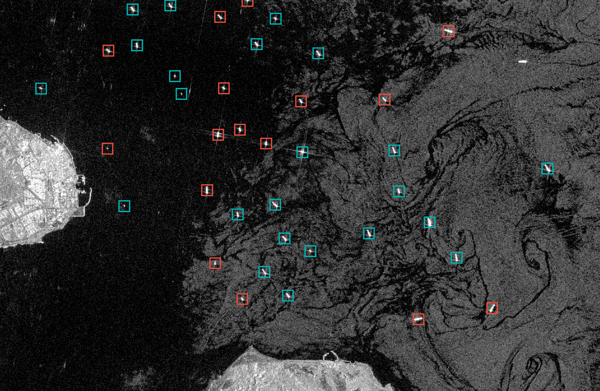
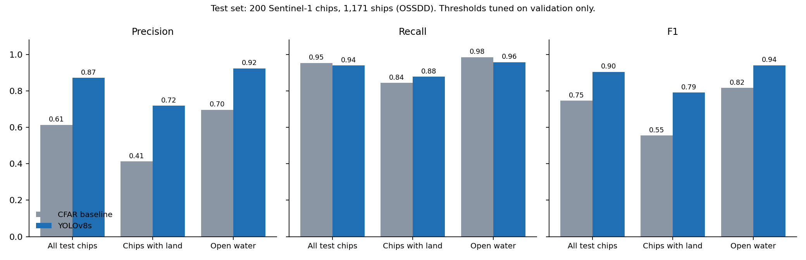
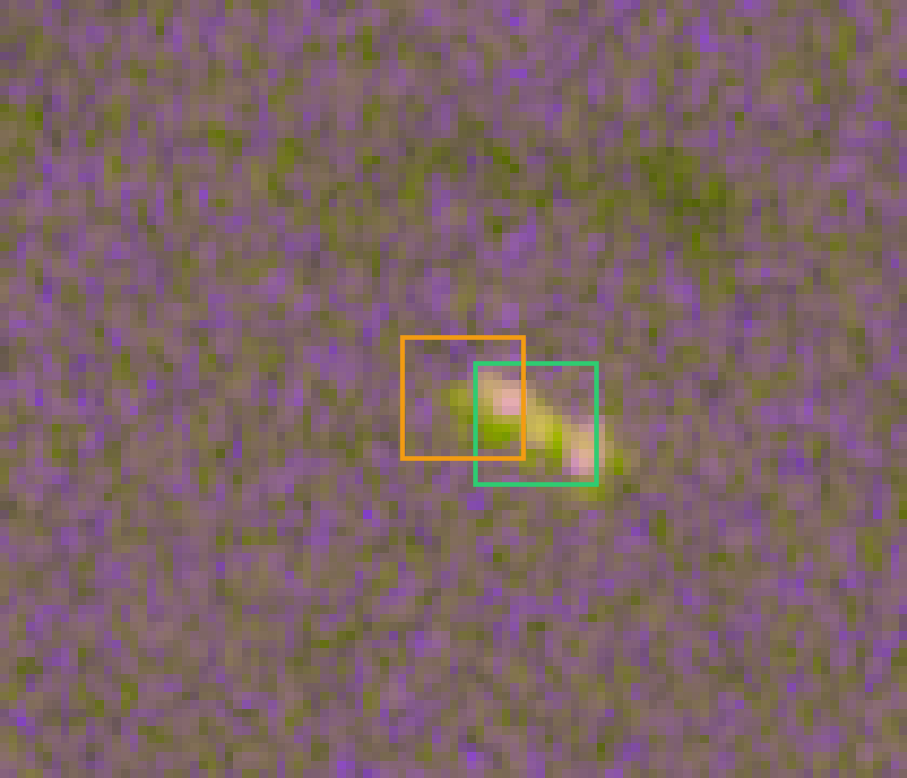
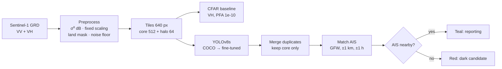

# Dark Vessel Detector (Gulf)

**Detecting ships in Sentinel-1 radar imagery and flagging those that are not broadcasting AIS, then applying the detector to Gulf waters it has never seen.**
Project 1 of 3 in *A Gulf Maritime Picture: three layers of intelligence for UAE ports and coastline*.

| | CFAR baseline | Fine-tuned YOLOv8s |
|---|---|---|
| F1 (200 test chips, 1,171 ships) | 0.75 | **0.90** |
| False alarms | 704 | **162 (−77 %)** |
| Gulf, 15 Oct 2026 | | Khalifa Port: 1 dark candidate of 13 vessels · Hormuz anchorage: 16 of 40 |



---

## 1. Problem
Ships report who and where they are through **AIS**, a self-reported radio transponder. Vessels involved in illegal fishing, sanctions evasion or smuggling switch it off. They disappear from **tracking**, but **radar satellites still see them**, day and night and through cloud. Matching radar detections against AIS gives a list of **dark-vessel candidates**: leads for an analyst, not proof (small boats aren't required to carry AIS, and reception can fail).

**Why it matters to Stellaria:** it's automated target recognition plus maritime and port intelligence, the same pattern as the Stella platform (fuse a sensor with tracking data), and directly relevant to **Orbion**, the maritime-intelligence joint venture with the Abu Dhabi Maritime Academy. Areas of interest: **Khalifa Port** (Abu Dhabi) and the **Strait of Hormuz**.

## 2. Research
Full notes with sources: [`docs/RESEARCH.md`](docs/RESEARCH.md) (section 0 is a decision matrix for every component). Key takeaways:
- **SAR:** ships are bright corner reflectors on dark sea; **VH** separates ships from sea clutter better than VV.
- **CFAR** is the operational standard detector (ESA SNAP, Global Fishing Watch) but struggles with clutter edges (coastlines) and many targets close together.
- **xView3** (NeurIPS 2022) is the reference dark-vessel benchmark. Even the winners scored much lower **near shore** (F1 ≈ 0.53 vs 0.77 overall); its train split has **AIS-only labels**, so it is blind to dark ships; the 4th-place team showed **fixed** normalisation beats per-chip normalisation.
- **Small objects:** ships are ~13 px at 10 m, so never resize; anchor-free detectors avoid anchor priors tuned to COCO's large objects.
- **AIS for the Gulf:** free per-ship AIS doesn't exist; Global Fishing Watch provides gridded AIS presence plus its own SAR detections.

## 3. Model choices
| Component | Chosen | Rejected (why) |
|---|---|---|
| Baseline | Two-parameter CFAR on VH | Global threshold (ignores sea state); OS-CFAR (too slow on full scenes) |
| Detector | **YOLOv8s** (anchor-free, fast, fits a 4 GB GPU) | **YOLO26s: tested, out of memory** (8.9 GB single allocation on the GTX 1650); CircleNet (xView3 winner, 12-model ensemble on 2 large GPUs); Faster R-CNN (0.19 in xView3); DETR (data-hungry, weak on small objects) |
| Input | VV, VH, VV−VH in dB, **fixed** scaling, native resolution | Per-chip min-max (destroys absolute brightness); resized tiles (ships vanish) |
| Dark flag | Detection + AIS presence within ~1 km and ±1 h | Learning "dark" as a class (it's a property of the AIS record, not the pixels) |
| Metric | xView3-style point matching (≤ 200 m), P/R/F1 + land vs open water | COCO mAP (IoU on marker boxes is meaningless here) |

Every decision, with alternatives and outcome: [`DECISIONS.md`](DECISIONS.md) (D01–D27).

## 4. Build vs reuse
- **Reused, pre-trained and fine-tuned:** **YOLOv8s from Ultralytics, pre-trained on the COCO dataset**, fine-tuned on Sentinel-1 ship chips. COCO weights give a complete detector; the low-level features (edges, blobs, contrast) transfer to SAR, where a ship is a bright compact blob. With ~600 training chips, training from scratch would underfit. SAR self-supervised backbones (SSL4EO-S12, CROMA) are the strongest alternative but are backbones, not detectors: next step.
- **Reused data and services:** OSSDD labels, Global Fishing Watch AIS, OpenStreetMap coastlines, Copernicus Sentinel Hub processing, the xView3 metric definition.
- **Built:** SAR calibration and encoding, core + halo tiling, CFAR baseline, land masks, evaluation with breakdowns, AIS matching and dark flag, the Gulf domain-shift fix, the demo app.

## 5. Data
| Data | Source | Use |
|---|---|---|
| **OSSDD** (Open SAR Ship Detection Dataset) | Hugging Face `sylviaHoch/OpenSARShip-Ship-Detection-Dataset` (CC BY-NC-SA 4.0) | Train / val / test: **595 / 200 / 200** Sentinel-1 VV+VH chips, 1,178 / 327 / 1,171 ships |
| Sentinel-1 over the Gulf | Copernicus Data Space, Sentinel Hub Process API (σ⁰, thermal noise removed, orthorectified, 10 m) | Khalifa Port and Hormuz scenes, 15 and 21 Oct 2026 |
| AIS | Global Fishing Watch 4Wings API (gridded ~1 km, hourly) | Dark-vessel flag on Gulf scenes |
| Coastlines | OpenStreetMap via Overpass | Land masks for the Gulf AOIs |
| xView3-SAR labels | iuu.xview.us (registration) | Downloaded and checksum-verified; per-ship dark scoring is the next step |

**Preprocessing:** OSSDD pixels are raw GRD amplitude, converted to approximate σ⁰ dB with σ⁰ = DN²/A² (A ≈ 550; the per-product LUT isn't shipped, ~1–2 dB error). Three channels VV, VH, VV−VH, clipped to fixed ranges. Train chips centre-cropped 700 → 640 px; val/test zero-padded 512 → 640 px; never resized.
**Splits:** OSSDD's own train/val/test. Thresholds tuned on **val only**, test used once.
How to download everything: [`data/README.md`](data/README.md).

## 6. Results
### Test set: 200 chips, 1,171 ships
| Metric | CFAR | YOLOv8s | Change |
|---|---|---|---|
| Precision | 0.61 | 0.87 | +0.26 |
| Recall | 0.95 | 0.94 | −0.01 |
| F1 | 0.75 | 0.90 | +0.16 |
| F1, chips with land | 0.55 | 0.79 | +0.24 |
| F1, open water | 0.82 | 0.94 | +0.12 |
| Recall, ships 40–120 m | 0.86 | 0.90 | +0.04 |
| False alarms | 704 | 162 | −77 % |

Chosen on validation: CFAR PFA 1e-10, YOLO confidence 0.15. Source: `results/metrics_cfar.json`, `results/metrics_yolov8s.json` (commands in section *Setup and run*). Training: 1.8 h on a GTX 1650, early-stopped at epoch 26 (best 21); curves in `runs/yolov8s/` (not committed, reproduced by training).



### Gulf scenes (no labels, so qualitative)
| Scene (15 Oct 2026, 02:14 UTC, same pass) | Vessels | AIS nearby | Dark candidates | GFW's own SAR |
|---|---|---|---|---|
| Khalifa Port | 13 | 12 | **1** | 6 matched, 3 unmatched |
| Hormuz, Larak–Qeshm anchorage | 40 | 24 | **16** | 13 matched, 17 unmatched; 30 of our 40 coincide |

Files: `results/gulf/*_dark_summary.json`, figures in `results/figures/`.

### Failure cases

- **CFAR fragmentation:** one ship → two detections (bright bow and stern).
- **CFAR coastline clutter:** clusters of hits along the Gulf shoreline.
- **YOLO misses** faint ships and motion-smeared ships with wakes.
- **Label noise:** some "false alarms" are unlabelled ships, so precision is a lower bound.
More: `results/failures/` (CFAR vs YOLO side by side) and `presentation/figures/failures/`.

## 7. Limitations and next steps
- **Domain shift (measured):** Sentinel Hub removes thermal noise, so calm Gulf sea becomes exact zeros (37 % of VH pixels at Khalifa, 58 % at Hormuz); the first Gulf run found 0 ships with CFAR. Fixed with a physics-based noise floor (training 1st percentile) and a speckle bound on CFAR's σ; test F1 unchanged (0.745 → 0.746). Still, Gulf performance is **not measured**: no Gulf labels.
- **Gridded AIS:** ~1 km cells make dark counts a **lower bound** in busy areas.
- **Dark flag not scored per ship** yet: needs xView3 imagery (123 GB).
- **Next:** xView3 dark-flag scoring; YOLO26s and a small-object head on a 16 GB GPU; SAR-pretrained backbone; label a few Gulf chips.

---

## Pipeline


## Setup and run
Tested on Windows 11, Python 3.14, GTX 1650 (4 GB). Paths are relative to the repo root.

```powershell
# 1. Install
pip install -r requirements.txt
# optional, GPU training/inference in a project venv:
python -m venv .venv --system-site-packages
.venv\Scripts\python -m pip install --ignore-installed --no-deps torch torchvision --index-url https://download.pytorch.org/whl/cu126

# 2. Tests (synthetic data, ~10 s)
python -m pytest -q tests

# 3. Data: OSSDD shards -> chips (see data/README.md for downloads)
python -m src.extract_ossdd                     # extract + PNG previews
python -m src.ossdd_to_yolo --shards data/raw/ossdd/webdataset --out data/processed/ossdd

# 4. Baseline and model
python -m src.eval_chips --data data/processed/ossdd --name cfar
powershell -ExecutionPolicy Bypass -File scripts\run_training.ps1   # trains + evaluates YOLOv8s (and YOLO26s if it fits)
python -m src.make_figures --models cfar yolov8s

# 5. Gulf (needs CDSE + GFW credentials in .env, see data/README.md)
python -m src.land_mask  --aoi aoi/khalifa_port.geojson --out data/interim/khalifa_port_land.geojson
python -m src.gulf_fetch fetch --aoi aoi/khalifa_port.geojson --date 2026-10-15 --out data/raw/gulf
python -m src.predict --scene data/raw/gulf/khalifa_port_2026-10-15.tif --detector yolo --weights runs/yolov8s/weights/best.pt --conf 0.15 --land-mask data/interim/khalifa_port_land.geojson --noise-floor -29.2 -31.9 --suffix _yolov8s_floor --out results/gulf
python -m src.gfw_ais    --aoi aoi/khalifa_port.geojson --date 2026-10-15 --hour 2 --out data/raw/gfw
python -m src.gulf_dark  --scene data/raw/gulf/khalifa_port_2026-10-15.tif --det results/gulf/khalifa_port_2026-10-15_yolov8s_floor.csv --gfw data/raw/gfw/khalifa_port_2026-10-15 --hour 2

# 6. Demo app (opens http://localhost:8501)
streamlit run "demo app/app.py"
```

## Repo layout
```
Dark Vessel Detector/
├── README.md                 this file
├── DECISIONS.md              decision log (D01–D27): choice, alternatives, reason, result
├── PHASE0_REPORT.md          data-access checks before building
├── requirements.txt
├── aoi/                      GeoJSON areas: Khalifa Port, Hormuz (open strait, Larak anchorage)
├── configs/train.yaml        shared training hyperparameters (SAR-specific augmentation)
├── data/README.md            how to download / prepare all data (raw data not committed)
├── demo app/app.py           Streamlit demo: CFAR vs YOLOv8s on test chips, live thresholds
├── docs/
│   ├── RESEARCH.md           research notes + decision matrix
│   └── TECHNICAL_EXPLAINER.md   plain-language → technical explanation with diagrams
├── presentation/             slide deck (Dark_vessel_updated.pptx) and its figures
├── results/                  metrics (JSON), predictions (CSV), figures, failure cases, Gulf outputs
├── scripts/                  training launchers
├── src/                      pipeline code (see docstrings; each module runs with python -m src.<name>)
└── tests/                    unit tests on synthetic data
```
