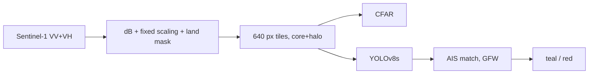

# Technical Explainer: Dark Vessel Detector

Every part of the project, **first in plain language, then in technical depth**, so it can be explained on a whiteboard without notes. Numbers come from `results/`; reasons are in `DECISIONS.md`.

---

## 0. The whole thing on one whiteboard

```
 SATELLITE RADAR IMAGE          FIND SHIPS                  CHECK AIS                 RESULT
 (Sentinel-1, VV + VH)   →   CFAR  or  YOLOv8s   →   any AIS ship within      →   teal = reporting
 bright dots = ships          (baseline) (model)       ~1 km and ±1 hour?           red  = dark candidate
```

**Plain:** radar sees every ship; AIS only shows ships that choose to report. Ships in the first but not the second are worth a look.



---

## 1. The data and its quirks

**Plain.** Sentinel-1 is a free European radar satellite. It sends microwaves and listens for the echo, so it works at night and through cloud. Calm sea bounces the signal away (dark); a steel ship bounces it straight back (bright dot). It records two "polarisations": VV shows sea texture, VH makes the sea darker so ships stand out.

**Technical.**
- Product: IW GRD (Interferometric Wide swath, Ground Range Detected), 10 m pixel spacing, ~20 m true resolution, dual-pol VV+VH (`1SDV`).
- Pixel value: backscatter σ⁰ (sigma-nought), used in dB: 10·log₁₀(σ⁰).
- **Speckle:** random interference makes even uniform sea grainy (multiplicative noise). GRD is multi-looked (~4.4 looks), so speckle in dB has a std of ~2.2 dB.
- **Quirks seen in this project:**
  - OSSDD (training) pixels are **raw amplitude DN**, not σ⁰ → calibrated approximately with σ⁰ = DN²/A², A ≈ 550.
  - Sentinel Hub (Gulf) **removes thermal noise and clips at 0** → calm sea becomes exact zeros (37–58 % of VH pixels).
  - Ships are tiny: median 13 × 12 px. Bright ships produce cross-shaped sidelobes; moving ships smear along-track with a wake.

**Training data: OSSDD.** Open Sentinel-1 VV+VH chips with ship boxes. Splits 595 / 200 / 200 chips (1,178 / 327 / 1,171 ships). A **chip** = a 640 × 640 px square cut from a full scene (6.4 × 6.4 km); full scenes (~25,000 px) don't fit a network.

**AIS data.** Global Fishing Watch API: AIS presence on a 0.01° grid (~1.1 km), hourly, plus GFW's own SAR detections (matched / unmatched to AIS).

---

## 2. Preprocessing

**Plain.** Make every image speak the same "language" before the model sees it: same units, same brightness scale, land blanked out, cut into tiles without shrinking the ships.

**Technical.**
1. **dB conversion and calibration** (above).
2. **3-channel encoding:** R = VV, G = VH, B = VV−VH, each clipped to a **fixed** range (VV/VH −50…20 dB, ratio −5…25 dB) and scaled to 0–255. Fixed, not per-chip, so a bright pixel means the same everywhere (per-chip min-max would stretch calm and rough sea to look alike).
3. **No-data** (swath edges) → 0 in all channels.
4. **Land mask:** xView3 `owiMask`; Gulf: OpenStreetMap coastlines → polygons (land is left of OSM coastline ways), rasterised onto the scene grid, buffered 100 m.
5. **Gulf noise floor:** clip VV ≥ −29.2 dB, VH ≥ −31.9 dB (OSSDD 1st percentile), so "below noise" looks like it did in training.
6. **Tiling, core + halo:**
```
 +------------------------------+
 |  halo 64 px (context only)   |
 |   +----------------------+   |
 |   |  core 512 px          |   |   keep a detection only if its centre is in the core
 |   |  (detections kept)    |   |   → every point in the scene belongs to exactly one core
 |   +----------------------+   |   → no duplicates, no cross-tile NMS
 +------------------------------+
           640 px tile
```

---

## 3. The baseline: CFAR

**Plain.** For every pixel, look at the sea around it. If the pixel is far brighter than its neighbourhood, call it a ship. The bar moves with the sea state, so rough sea doesn't flood it with false alarms.

**Technical: two-parameter CFAR on VH (dB).**
```
        background ring (81 px)
   +---------------------------+
   |    guard (41 px)          |     detect if  x > μ_b + k·σ_b
   |   +-------------+         |     μ_b, σ_b = mean / std of the ring
   |   |   pixel x   |         |     k from PFA (Gaussian):  PFA 1e-10 → k ≈ 6.4
   |   +-------------+         |     σ_b ≥ 2.2 dB (speckle bound)
   +---------------------------+
```
- Guard ≈ largest ship (keeps the ship out of its own background); background ≈ 800 m for stable statistics (ESA SNAP's rule).
- Fast: box sums with uniform filters (integral-image idea), constant cost per pixel.
- Hits → connected components (≥ 2 px) → intensity-weighted centroids.
- PFA tuned on validation: 1e-10.
- **Weaknesses seen:** splits one ship into two hits (bright bow and stern); fires on coastlines and harbour structures; can't tell ships from platforms.

---

## 4. The model: fine-tuned YOLOv8s

**Plain.** Take a detector that already learned to find objects in ~118,000 everyday photos (COCO dataset), and teach it what ships look like in radar. Early layers (edges, blobs) are reused; later layers are re-learned.

**Technical.**
- **YOLOv8s** (Ultralytics, 11 M parameters): CSP backbone with C2f blocks → PAN-FPN neck → **anchor-free decoupled head** at strides 8/16/32. Task-Aligned Assigner for matching predictions to targets; losses = BCE (class) + CIoU + Distribution Focal Loss (box); NMS at inference.
- **Why it fits:** anchor-free (no COCO-sized anchors that ignore tiny ships); fast; pre-trained head.
- Weights: `models/yolov8s.pt` (COCO) → fine-tuned → `runs/yolov8s/weights/best.pt`.
- One class (`vessel`) on OSSDD; real ship boxes, evaluated by centre point.

```
 input 640×640×3 → [backbone: features] → [neck: mix scales] → [head: boxes + scores at 80², 40², 20² grids] → NMS → detections
```

---

## 5. Training setup

**Plain.** Show the model the 595 training chips many times, check it on 200 validation chips after each pass, and stop when it stops improving.

**Technical.**
- Batch 8, image size 640, up to 40 epochs, **early stopping** (patience 10) → stopped at 26, best epoch 21; 1.8 h on a GTX 1650.
- FP32 only: Ultralytics disables mixed precision on GTX 16-series (NaN risk).
- **Augmentation changed for SAR:** no hue/saturation (channels are physics), scale ±20 % (not ±50 %), vertical + horizontal flips, mild brightness (calibration differences), mosaic on (off for the last 10 epochs), no mixup.
- Optimiser: Ultralytics "auto" with cosine LR schedule, seed 0, deterministic.

---

## 6. Loss and metrics

**Plain.** During training the model is penalised for wrong boxes and wrong confidence. To judge it, count found ships, false alarms and misses.

**Technical.**
- Training loss: classification BCE + box CIoU + DFL (Ultralytics defaults).
- **Evaluation: point matching (xView3 style).** Distance matrix between predicted and true centres → **Hungarian assignment** (optimal one-to-one) → pair counts if ≤ 200 m (20 px).
  - Precision = TP / (TP + FP): how many alarms are real.
  - Recall = TP / (TP + FN): how many ships were found.
  - F1 = harmonic mean.
- Breakdowns: chips with land vs open water (OSSDD `land_fraction`), recall by ship size.
- **Why not mAP:** IoU on marker boxes doesn't measure "did we find the ship".
- **Why Hungarian, not greedy:** in dense anchorages greedy nearest-neighbour can steal a match and cause a false positive and a miss at once (unit-tested).

---

## 7. Evaluation design

**Plain.** Never let the test set influence choices. Pick the settings on validation, then test once.

**Technical.**
- CFAR PFA swept on val {1e-3 … 1e-12} → 1e-10. YOLO confidence swept on val {0.05 … 0.7} → 0.15.
- Test: 200 chips, 1,171 ships, scored once with those settings.
- Gulf: no labels → qualitative checks (visual, agreement with GFW's own SAR detections, plausibility of dark rates).

**Results (test).** CFAR P 0.61 / R 0.95 / F1 0.75 / 704 false alarms → YOLOv8s P 0.87 / R 0.94 / F1 0.90 / 162 false alarms. Land chips 0.55 → 0.79; open water 0.82 → 0.94.

---

## 8. The dark-vessel flag

**Plain.** For each detected ship, ask Global Fishing Watch: "was any AIS-broadcasting ship in this spot at this time?" If not, mark it red.

**Technical.**
- Cell of each detection = round(lat / 0.01°), round(lon / 0.01°).
- AIS-matched if any GFW AIS presence in that cell or the 8 neighbours (≈ ±1 km) within ±1 h of the acquisition hour. Else dark candidate. Fixed structures never flagged (xView3 path; OSSDD has only vessels).
- Not learned from pixels: "dark" is a property of the AIS record.
- **Limits:** gridded → lower bound in busy cells; GFW latency 4–5 days; small boats legally without AIS.
- **Gulf, 15 Oct 2026:** Khalifa 1 / 13 dark; Hormuz anchorage 16 / 40; GFW's own SAR 17 / 30 unmatched; 30 of our 40 coincide with GFW detections.

---

## 9. Domain shift (why the Gulf is different)

**Plain.** The model learned from European-style radar chips with the receiver's background noise still in them. The Gulf images were calmer and had the noise removed, so the sea looked "too dark", darker than anything in training. The first run broke; a noise floor fixed it.

**Technical.**
| | OSSDD | Khalifa | Hormuz |
|---|---|---|---|
| VV median | −18.7 dB | −22.7 dB | −24.4 dB |
| VH median | −25 dB | −36 dB | below noise |
| VH = 0 | none | 37.5 % | 57.6 % |
- Effect: CFAR σ_b inflated by zeros → 0 detections; YOLO missed an obvious ship.
- Fix: noise floor (training 1st percentile) + CFAR σ_b ≥ 2.2 dB. Test F1 unchanged (0.745 → 0.746).
- Other shift factors to mention: calmer sea, dense anchorages, oil infrastructure, different coastline.

---

## 10. Why each choice was made (one line each)

| Choice | One-line reason |
|---|---|
| Radar, not optical | Works at night and through cloud |
| OSSDD for training | Only open Sentinel-1 dual-pol ship set without registration |
| COCO-pretrained YOLOv8s | Full detector out of the box; features transfer; ~600 chips too few for scratch |
| CFAR baseline | The operational standard the model must beat |
| VH for CFAR | Sea darker in VH, so ships stand out |
| Fixed scaling | Keeps absolute brightness meaningful |
| Never resize | Ships are ~13 px |
| Core + halo tiles | Every ship counted exactly once |
| Point matching | Measures "found the ship", like xView3 |
| Tune on val, test once | Honest numbers |
| GFW AIS | Only free AIS covering the Gulf |
| OSM land mask | Captures Khalifa's reclaimed land |
| Noise floor | Gulf "below-noise" sea made to look like training |
